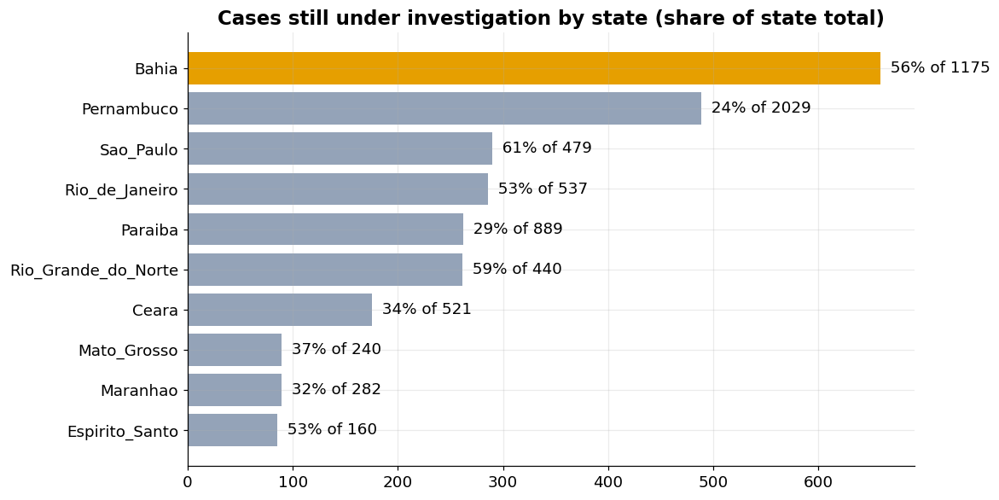
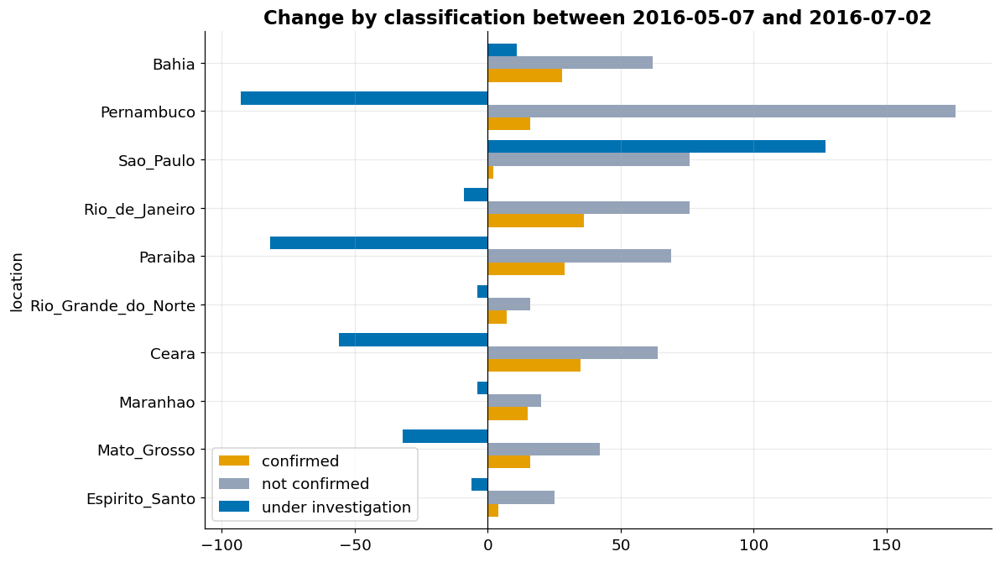
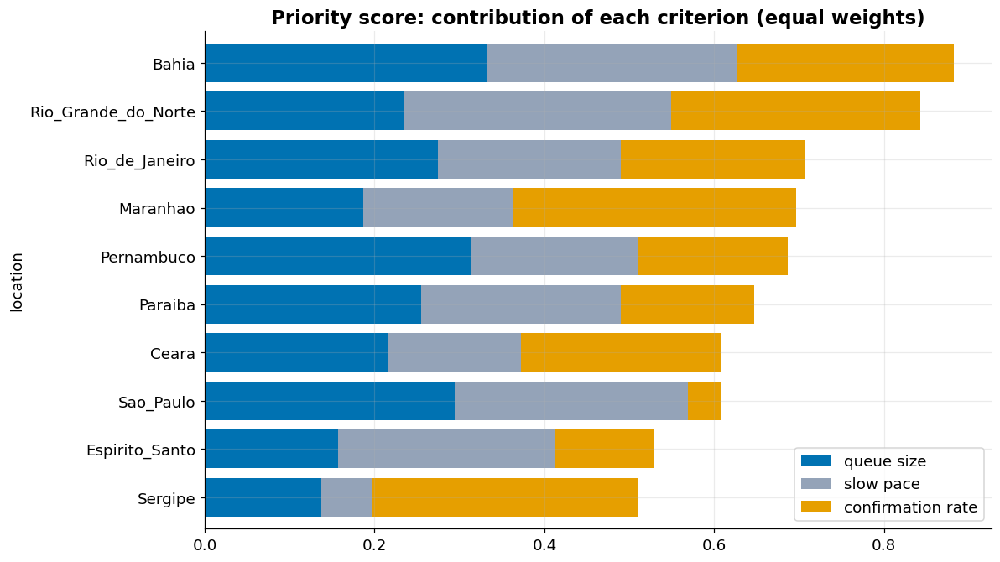
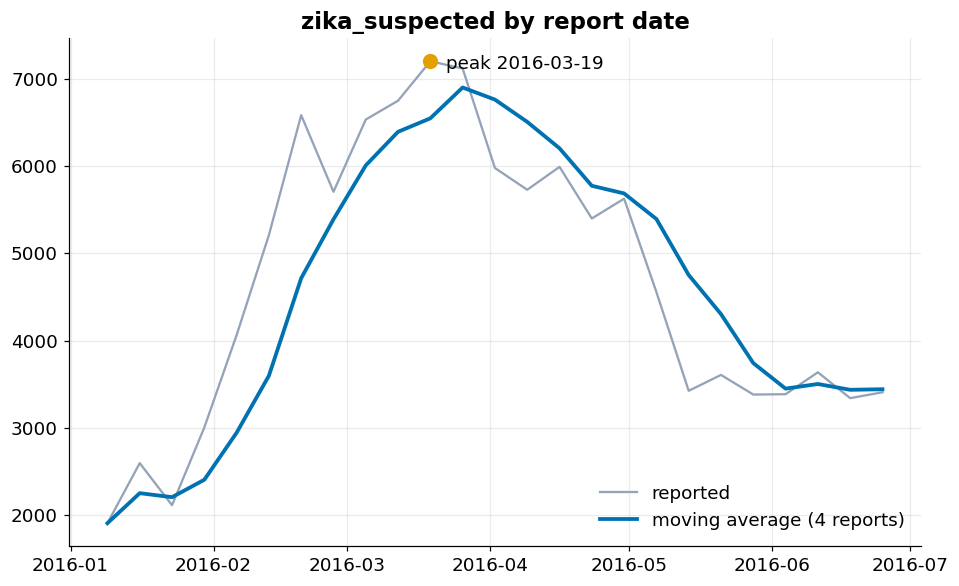
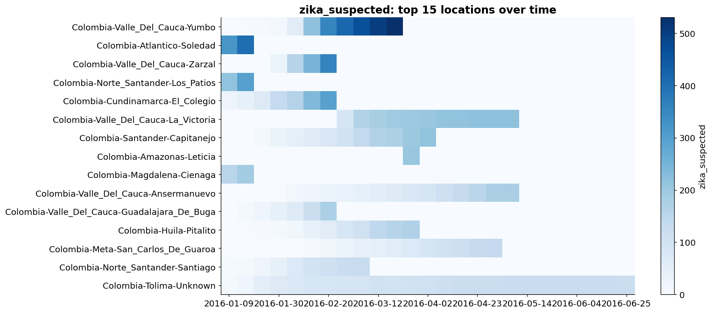
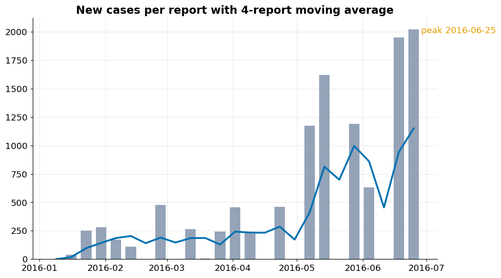
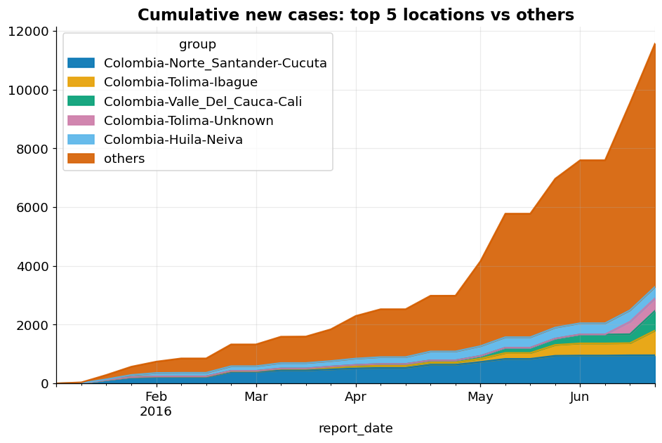
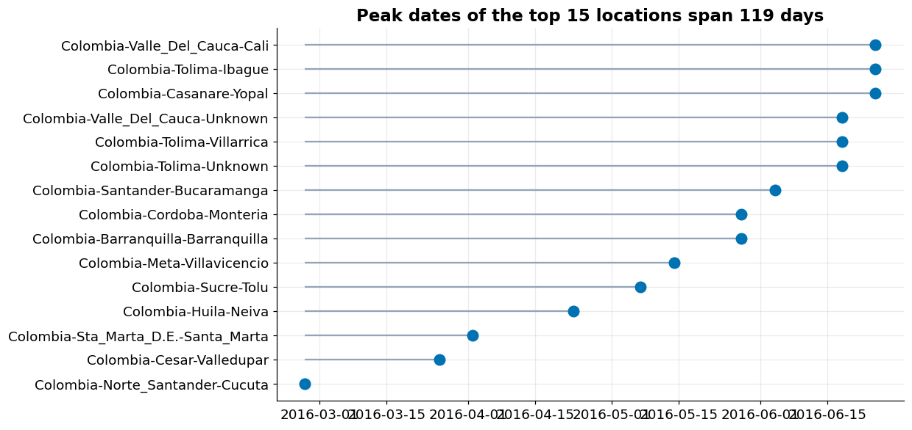
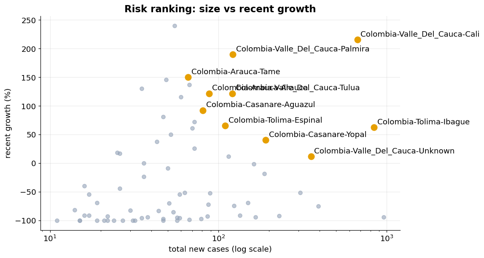

# Zika Virus Epidemic: Early Warning Analysis for Brazil and Colombia


Time series analysis of the CDC Zika Virus Epidemic dataset. The main analysis looks at where the investigation of microcephaly cases was stuck across Brazilian states in 2016 and whether the data supports a forecasting model. A second, exploratory part looks at how Zika case reports evolved across Colombian municipalities.

## Table of Contents

- [Business Problem](#business-problem)
- [Objectives](#objectives)
- [Dataset](#dataset)
- [Scope of the Analysis](#scope-of-the-analysis)
- [Methodology](#methodology)
- [Key Findings: Brazil](#key-findings-brazil)
- [Forecasting Experiment](#forecasting-experiment)
- [Exploratory View: Zika Cases in Colombia](#exploratory-view-zika-cases-in-colombia)
- [Limitations](#limitations)
- [How to Reproduce](#how-to-reproduce)
- [Tech Stack](#tech-stack)
- [Next Steps](#next-steps)
- [Author](#author)

## Business Problem

**Early Warning and Case Forecasting for Zika Virus Outbreaks Across the Americas**

The Zika epidemic of 2015-2016 spread quickly across Latin America and the Caribbean and was linked to severe complications such as microcephaly in newborns and Guillain-Barre syndrome. Health agencies reported cases at different geographic levels and in inconsistent formats, which made it hard to see where the outbreak was growing and where to send resources first.

A public health agency needs to anticipate where and when cases will rise so it can allocate limited resources (testing kits, vector control teams, hospital capacity, prenatal screening) before the outbreak peaks. Today, decisions rely on delayed and heterogeneous reports, with no consolidated view of how the epidemic evolves by location and indicator, and no forecast to support proactive planning.

**Stakeholders:** ministries of health, regional epidemiology teams, hospital networks and international health organizations.

## Objectives

1. Consolidate and standardize the epidemiological reports by location, indicator and reporting period.
2. Analyze the temporal and geographic evolution of the outbreak and identify the most affected regions.
3. Forecast reported cases per location for the next reporting periods.
4. Rank locations by risk level to prioritize intervention.

## Dataset

Source: [CDC Zika Virus Epidemic on Kaggle](https://www.kaggle.com/datasets/cdc/zika-virus-epidemic).

The full dataset has 107,238 rows and 9 columns, with one row per reported indicator:

| Column | Description |
|---|---|
| `report_date` | Date the report was published |
| `location` | Country, state or municipality name |
| `location_type` | Geographic level of the location |
| `data_field` | Indicator being reported |
| `data_field_code` | Standardized code for the indicator |
| `time_period` | Reference period of the measurement |
| `time_period_type` | Type of period |
| `value` | Reported numeric value |
| `unit` | Unit of the value |

## Scope of the Analysis

**Brazil (main analysis).** The Brazilian subset has **4,132 rows**, all at state level, covering **27 states** and **21 weekly reports** from 2016-02-13 to 2016-07-02.

Indicators available for Brazil:

| Indicator | Unit | Meaning |
|---|---|---|
| `microcephaly_confirmed` | cases | Notifications confirmed as microcephaly |
| `microcephaly_not` | cases | Notifications discarded |
| `microcephaly_under_investigation` | cases | Notifications still pending classification |
| `microcephaly_fatal_*` | cases | Same classification, for fatal cases |
| `municipality_microcephaly*` | municipalities | Count of municipalities, not people |
| `zika_reported` | cases | Reported Zika cases, only 7 report dates |

Decisions that shape the Brazilian analysis:

- The three classification indicators describe the same pool of notifications, so they are analyzed together as confirmed, discarded and pending.
- Municipality indicators count places, not people, and are never summed with case counts.
- `zika_reported` has too few dates for a time series and includes a row named `Brazil` that is the national total tagged as a state, so it is excluded from state-level sums to avoid double counting.
- Pending cases are a stock, not a flow: they drop when cases are classified and rise with new notifications. Differences between reports are therefore read as net change, not as new cases.

**Colombia (exploratory).** The municipality-level Zika indicators come from Colombia, with about 25 weekly reports from January to June 2016. Locations are named `Colombia-Department-Municipality`, and some use an `Unknown` bucket when the municipality is not identified. This part uses suspected cases (`zika_suspected`) and a confirmed-case indicator. It is descriptive and was not developed into a model.

## Methodology

1. **Data loading and checks:** download via the Kaggle API, type conversion, duplicate key check (none found) and coverage check per report date.
2. **Exploration:** evolution of confirmed, discarded and pending cases nationally and by state.
3. **Backlog analysis:** pending cases per state in the latest report, compared with 8 reports earlier (2016-05-07 to 2016-07-02), decomposed into confirmed, discarded and pending changes.
4. **Priority ranking:** equal-weight score built from percentile ranks of three criteria, restricted to states with at least 50 resolved cases (17 of 27 states):
   - queue size (pending cases);
   - slow pace (resolved cases in the window divided by the current queue);
   - confirmation rate among resolved cases.
5. **Sensitivity of the ranking:** 1,000 random weight combinations, counting how often each state lands in the top 3.
6. **Forecasting experiment:** next-week change in confirmed cases, tested against naive baselines on the 4 most recent reports.
7. **Exploratory Zika view for Colombia:** timeline with a 4-report moving average, municipality heatmap, new cases per report, cumulative share of the five largest municipalities, timing of peaks, and size versus recent growth (last 4 reports against the previous 4, only for municipalities with at least 10 cases in the earlier period).

Each finding was checked for sample size, for share versus risk, and for alternative explanations before being written down.

## Key Findings: Brazil

**National picture**

- Notifications grew from about 5.3 thousand to 8.3 thousand between February and July 2016.
- The pending queue fell from roughly 3 in every 4 notifications to about 1 in 3 (3,130 of 8,301 in the last report).
- Among resolved cases, 68% were discarded (3,515 discarded against 1,656 confirmed).
- Ten states hold 86% of the pending queue.

**Where the investigation is stuck**

- **Bahia:** largest queue (659 pending), with 265 confirmed cases. The queue did not shrink in two months (648 to 659), and only 14% of it was classified.
- **Rio Grande do Norte:** 261 pending, 63% of resolved cases confirmed, and only 23 cases classified in two months.
- **Sao Paulo:** queue grew from 163 to 290. About 205 new notifications came in against 78 classified, and about 97% of the classified cases were discarded. This looks like a triage capacity problem rather than an outbreak response problem.
- **Pernambuco, Paraiba and Ceara:** concentrate confirmed cases and are classifying well. The priority there is follow-up of already confirmed cases, not the queue.
- **Sergipe and Tocantins:** their queues shrank through one-off reviews (Sergipe confirmed 77 cases across three reports in May and June, Tocantins discarded 48 in a single report on 2016-06-04), so they are not a reference for a sustainable pace.
- **Minas Gerais:** small queue (64) with no case classified in two months, even though the state reported on every date. A point of attention, not a priority.





A shrinking queue does not say what was decided: Pernambuco reduced its queue mostly by discarding cases (92% of those classified), while Bahia and Rio de Janeiro kept a flat queue because about 100 new notifications entered in each state while they classified 90 and 112 cases.

**Priority ranking robustness**

Across 1,000 random weight combinations, **Bahia** was in the top 3 in 95% of draws and **Rio Grande do Norte** in 89%. The third place depends on the weights: Maranhao (43%), Pernambuco (25%), Sao Paulo (21%) and Rio de Janeiro (12%).

The ranking measures where investigation is most stalled and most likely to yield confirmations. It does not measure outbreak size (Pernambuco) or queue growth (Sao Paulo).



## Forecasting Experiment

Target: change in confirmed microcephaly cases per Brazilian state in the next report. Features: the last three weekly changes, plus pending cases and their change. Test set: the 4 most recent reports, with one report skipped between training and test to avoid leakage. Mean absolute error in cases per state per week:

| Model | MAE |
|---|---|
| Repeat last value (change = 0) | 0.97 |
| Repeat last change | 1.54 |
| Ridge regression, 3 lags | 1.59 |
| Linear regression, 3 lags | 1.60 |
| Linear regression, 3 lags + pending queue | 1.56 |

**Conclusion:** neither regression beat the simplest baseline, with or without the pending queue as a feature. In the final weeks the confirmed counts barely move, and "stays the same" is the best guess. With 21 reports the Brazilian state series supports descriptive analysis, not forecasting. The pending queue showed the expected sign (more pending cases, slightly more confirmations the following week), but the effect was too small to improve predictions.

## Exploratory View: Zika Cases in Colombia

This part asks a different question from the Brazilian analysis: when and where did Zika case reports grow, and does the timing of peaks give any lead time? It is descriptive, and the reporting pattern (see the cautions below) limits what can be concluded.

**What the charts show**

1. **Suspected cases rose, then roughly halved.** Summed over municipalities, `zika_suspected` rose from about 1,900 in January to a peak of about 7,200 on 2016-03-19, fell to about 3,400 by early June and stayed there.



2. **Reports come from a changing set of municipalities.** Among the 15 municipalities with the highest suspected values, 14 stop appearing before the last report, some after only two reports (Soledad, Los Patios). Only `Tolima-Unknown` has data through the end. Yumbo has the largest values (above 500 in mid-March) and then disappears. The fall of the total after March therefore mixes a real decline with municipalities leaving the reports, and the data does not separate the two.



3. **Confirmed cases accelerate late in the series.** New cases per report stay mostly below 500 until April, reach about 1,000 to 1,600 in May and early June, and hit about 1,950 and 2,020 in the last two reports. The last one, on 2016-06-25, is the highest of the series, and the 4-report average was still rising at the end.



4. **Reporting is lumpy.** Several report dates add zero cases and are followed by large jumps, so part of the late surge may be catch-up of delayed reports. The last two reports alone add about 4,000 of the roughly 11,600 cumulative cases, about a third.

5. **Cases are spread across many municipalities.** The five largest (Cucuta, Ibague, Cali, `Tolima-Unknown` and Neiva) account for about 3,300 of the 11,600 cumulative cases, under 30%. Cucuta rose early and flattened by June, while Cali and Ibague climbed in June.



6. **Peaks are staggered in time.** Among the 15 largest municipalities, peak dates span 119 days, from 2016-02-27 (Cucuta) to 2016-06-25 (Cali, Ibague and Yopal). Six of the 15 peak in the last two reports, so for them the "peak" is just the last observation and the outbreak was probably still growing when the data ends.



7. **Fastest growth clusters by department.** In the size versus recent growth view, the ten highlighted municipalities include four in Valle del Cauca (Cali, Palmira, Tulua and an `Unknown` bucket), two in Tolima (Ibague, Espinal), two in Casanare (Yopal, Aguazul) and two in Arauca (Tame and one more). Cali is the largest of them (about 670 cases, growth above 200%), followed by Ibague (about 830 cases, growth above 60%). Many municipalities sit at about -100%, meaning no cases in the last four reports. Given the reporting pattern above, that fits municipalities that stopped reporting more than epidemics that ended.



**Implication for the business problem**

Two signals would be useful for an early-warning use case, provided they hold up with cleaner reporting data. First, peaks arrive in different places up to four months apart, which leaves time to position resources in places that peak late. Second, at the end of the data the fastest growth is concentrated in Valle del Cauca, Tolima, Casanare and Arauca, with Cali and Ibague as the largest, so those are the first places to check against newer reports. Both depend on the late surge not being a reporting catch-up.

**Reading these results with care**

- The data does not say whether a municipality that disappears had zero cases or stopped reporting. The heatmap fills gaps with zero.
- A peak on the last report date is censored: it shows where the data ends, not where the outbreak peaked.
- Growth percentages come from short windows (4 reports against 4) and municipalities with small bases are noisy.
- The staggered peaks and the department clusters describe association in reported data, not spread or causes.

## Limitations

- 21 weekly reports for Brazil are too few for a reliable forecast, and the test window is only 4 reports.
- The data does not separate new notifications from reclassifications, so "new notifications" is an estimate (sum of the three classification changes).
- Batch reclassifications by some states distort the pace measured over a two-month window.
- The priority score depends on equal weights, which is an assumption and not an agency rule.
- Brazilian Zika cases (7 dates) are too few for time series work.
- Colombian reports are intermittent: municipalities enter and leave the reports, some dates add no cases, and `Unknown` buckets hide the municipality. This weakens any reading of totals over time.
- It is not clear from the data whether `zika_suspected` is a weekly count or a snapshot, which affects how the decline after March should be read.
- Findings describe the situation in 2016 and show association, not causation.

## How to Reproduce

The analysis runs in Google Colab. The Kaggle token is stored in Colab Secrets under the name `kaggle_api`.

```python
import os
from google.colab import userdata

# read token from colab secrets / ler o token dos secrets do colab
os.environ["KAGGLE_API_TOKEN"] = userdata.get("kaggle_api")
```

```bash
pip install -q --upgrade kaggle
kaggle datasets download -d cdc/zika-virus-epidemic -p /content/data --unzip
```

Then run the notebook cells in order. The Brazilian subset is obtained by filtering `location` for "brazil", and the Colombian one for "colombia". The charts in this README are stored in the `img` folder.

## Tech Stack

Python, pandas, NumPy, Matplotlib, scikit-learn, Kaggle API, Google Colab.

## Next Steps

- Rolling backtest with several test windows to check whether the regression only fails because the final weeks changed regime.
- Normalize the pending queue by state size before testing it as a predictor.
- Test a forecasting model on the Colombian municipal series (about 25 weekly reports and many municipalities), after handling intermittent reporting, and compare it with the same naive baselines used for Brazil.
- Check whether the late surge in Colombia is a reporting catch-up, for example by comparing the number of municipalities reporting on each date.
- Add the Zika case counts to the Brazilian state view, separating the national total from the states.
- Build a dashboard version of the priority ranking.

## Author

Rafael, data scientist. Dataset by CDC, distributed through Kaggle.
